# Class diagram

Generated by `node server/scripts/class-diagram.mjs`. Do not hand-edit.

Arrows are constructor dependencies: `A --> B` means A is given a B.

```mermaid
classDiagram
  namespace trace {
    class TraceLimits {
      <<interface>>
    }
    class TraceFile {
      write()
      read()
      prune()
    }
    class TraceFormat {
      file()
      line()
      elapsed()
      fields()
      value()
      url()
    }
    class TraceSink {
      <<interface>>
      write()
    }
    class TraceStep {
      <<interface>>
    }
    class TraceScope {
      <<interface>>
    }
    class Trace {
      install()
      within()
      withinTool()
      line()
      tick()
    }
    class Pending {
      <<interface>>
    }
    class UndiciRequest {
      <<interface>>
    }
    class NodeRequest {
      <<interface>>
    }
    class WireTap {
      attach()
    }
  }
  namespace domain {
    class Account {
      <<interface>>
    }
    class User {
      <<interface>>
    }
    class UserListing {
      <<interface>>
    }
    class Principal {
      <<interface>>
    }
    class Scope {
      of()
      forViewer()
      admits()
    }
    class AdQuery {
      <<interface>>
    }
    class AdHit {
      <<interface>>
    }
    class AdPage {
      <<interface>>
    }
    class StoredAd {
      <<interface>>
    }
    class ReadAd {
      <<interface>>
    }
    class Markets {
      countries()
    }
    class ChargeDraft {
      <<interface>>
    }
    class Charge {
      <<interface>>
    }
    class ChargeMeter {
      <<interface>>
      charge()
    }
    class ServiceUse {
      <<interface>>
    }
    class Competitor {
      <<interface>>
    }
    class CompetitorRelationship {
      classify()
      domainOf()
    }
    class Clock {
      nowIso()
    }
    class Ids {
      next()
    }
    class RunEvent {
      <<interface>>
    }
    class LlmCallRecord {
      <<interface>>
    }
    class Generation {
      <<interface>>
    }
    class LlmCall {
      <<interface>>
    }
    class PageFetcher {
      <<interface>>
      scrape()
    }
    class WebSearch {
      <<interface>>
      find()
    }
    class AdLibrary {
      <<interface>>
      search()
    }
    class ReviewSource {
      <<interface>>
      collect()
    }
    class Storefront {
      <<interface>>
      inspect()
    }
    class GenerationSource {
      <<interface>>
      generation()
    }
    class AccountDirectory {
      <<interface>>
      addAccount()
      account()
      accountNamed()
      addUser()
      user()
      byUsername()
      users()
      setPassword()
    }
    class RunStore {
      <<interface>>
      create()
      get()
      list()
      updateRun()
      unfinished()
    }
    class ProductStore {
      <<interface>>
      upsert()
      get()
      saveBrief()
    }
    class CompetitorStore {
      <<interface>>
      confirm()
      list()
      saveProfile()
    }
    class ReviewStore {
      <<interface>>
      save()
      recordSources()
      coverage()
      list()
    }
    class AdStore {
      <<interface>>
      save()
      saveReading()
      list()
    }
    class EventLog {
      <<interface>>
      add()
      list()
    }
    class ChargeLedger {
      <<interface>>
      add()
      list()
    }
    class CallLog {
      <<interface>>
      add()
      setGeneration()
      list()
    }
    class ResearchStore {
      <<interface>>
      close()
    }
    class Product {
      <<interface>>
    }
    class CollectedReview {
      <<interface>>
    }
    class ReviewTarget {
      <<interface>>
    }
    class StoredReview {
      <<interface>>
    }
    class ReviewCoverage {
      <<interface>>
    }
    class StorefrontFacts {
      <<interface>>
    }
    class Asins {
      fromUrl()
    }
    class Run {
      <<interface>>
    }
    class RunUpdate {
      <<interface>>
    }
    class Schemas {
      json()
      parse()
    }
    class ServicePart {
      <<interface>>
    }
    class ServiceReport {
      <<interface>>
    }
    class StagePlan {
      <<interface>>
    }
    class StageState {
      <<interface>>
    }
    class Stages {
      initial()
      ended()
    }
    class SearchHit {
      <<interface>>
    }
    class SearchPage {
      <<interface>>
    }
    class SearchScope {
      <<interface>>
    }
    class FetchedPage {
      <<interface>>
    }
    class ServiceUnavailableError {
    }
  }
  namespace config {
    class ServicePrices {
      <<interface>>
    }
    class Settings {
      <<interface>>
    }
    class Env {
      text()
      required()
      list()
      backups()
      number()
      optionalNumber()
      flag()
      settings()
    }
  }
  namespace adapters {
    class Crawl4aiPayload {
      <<interface>>
    }
    class Crawl4ai {
      scrape()
    }
    class FallbackPageFetcher {
      scrape()
    }
    class FirecrawlPayload {
      <<interface>>
    }
    class Firecrawl {
      scrape()
    }
    class Http {
      withTimeout()
    }
    class MeteredWebSearch {
      find()
    }
    class MeteredPageFetcher {
      scrape()
    }
    class MeteredAdLibrary {
      search()
    }
    class OpenRouterGeneration {
      parse()
    }
    class OpenRouterPrices {
      start()
      refreshPrices()
      ratesFor()
      generation()
      stop()
    }
    class ParallelApi {
      post()
      get()
    }
    class ParallelUsage {
      <<interface>>
    }
    class ParallelResult {
      <<interface>>
    }
    class ParallelSearch {
      find()
    }
    class PublicUrls {
      assert()
    }
    class RateLimitWait {
      askedMs()
      withMarginMs()
      sleep()
    }
    class Rates {
      <<interface>>
    }
    class Pricing {
      <<interface>>
    }
    class Billed {
      <<interface>>
    }
    class Money {
      perMillion()
      rates()
    }
    class JudgemeReview {
      <<interface>>
    }
    class JudgemePage {
      <<interface>>
    }
    class JudgemeReviews {
      collect()
      review()
    }
    class ReviewText {
      fromHtml()
      decode()
    }
    class WootReview {
      <<interface>>
    }
    class WootPage {
      <<interface>>
    }
    class WootReviews {
      collect()
      review()
      date()
    }
    class ServiceClients {
      forSettings()
    }
    class Waiter {
      <<interface>>
    }
    class ServiceQueue {
      run()
    }
    class ShopifyStorefront {
      inspect()
      apps()
    }
    class AccountTable {
      addAccount()
      account()
      accountNamed()
      addUser()
      user()
      byUsername()
      users()
      setPassword()
    }
    class AdTable {
      save()
      saveReading()
      list()
    }
    class CallTable {
      add()
      setGeneration()
      list()
    }
    class ChargeTable {
      add()
      list()
    }
    class CompetitorTable {
      confirm()
      list()
      saveProfile()
    }
    class EventTable {
      add()
      list()
    }
    class Migrator {
      checksum()
      migrate()
    }
    class PostgresStatements {
      all()
      get()
      run()
      exec()
      transaction()
      close()
    }
    class PostgresDatabase {
      connect()
      all()
      get()
      run()
      exec()
      transaction()
      close()
    }
    class PostgresDialect {
      statement()
      parser()
    }
    class ProductTable {
      upsert()
      get()
      saveBrief()
    }
    class ReviewTable {
      contentHash()
      save()
      recordSources()
      coverage()
      list()
    }
    class RunTable {
      create()
      get()
      list()
      updateRun()
      unfinished()
    }
    class SqlDatabase {
      <<interface>>
      all()
      get()
      run()
      exec()
      transaction()
      close()
    }
    class SqlResearchStore {
      open()
      close()
    }
    class Migration {
      <<interface>>
    }
    class ThrottledPageFetcher {
      scrape()
    }
    class ThrottledWebSearch {
      find()
    }
    class ThrottledAdLibrary {
      search()
    }
    class TrendtrackAd {
      <<interface>>
    }
    class TrendtrackAds {
      search()
    }
  }
  namespace agent {
    class AnalysisService {
      start()
      confirm()
      stop()
      get()
      recover()
    }
    class AgentJob {
      <<interface>>
    }
    class AgentRunnerDeps {
      <<interface>>
    }
    class AgentRunner {
      run()
    }
    class BilledCosts {
      settled()
    }
    class CallSequence {
      next()
      track()
      written()
    }
    class LlmCallLog {
      wrap()
    }
    class ModelChain {
      resolve()
      failover()
      withFallbacks()
    }
    class RetryPolicy {
      <<interface>>
    }
    class Retries {
      isRetryable()
      backoffMs()
      sleep()
    }
    class RunMeter {
      charge()
    }
    class Submission {
      <<interface>>
    }
    class SubmitTool {
      tool()
    }
    class ToolSteps {
      start()
      take()
    }
    class TurnPolicy {
    }
    class UsageTotals {
      tokens()
    }
    class LiveRun {
      <<interface>>
    }
    class LiveRuns {
      start()
      has()
      stop()
      stopAll()
    }
    class LlmModels {
      openrouter()
    }
    class Pipeline {
      run()
    }
    class RunServices {
      <<interface>>
    }
    class RunContext {
      kit()
      meter()
      agent()
      emit()
      settled()
    }
    class RunEvents {
      emit()
      subscribe()
      flushed()
    }
    class StageProgress {
      state()
      started()
      ended()
      snapshot()
    }
    class StageInput {
      <<interface>>
    }
    class StageOutcome {
      <<interface>>
    }
    class Stage {
      <<interface>>
      run()
    }
    class ProductResolver {
      resolve()
      problems()
    }
    class RunVerdict {
      <<interface>>
    }
    class RunEnd {
      verdict()
      end()
    }
    class RunLauncher {
      chain()
      resolve()
      research()
    }
    class AdKeywordsAgent {
      pick()
    }
    class AdReader {
      read()
      problems()
    }
    class SweepPlan {
      <<interface>>
    }
    class SweepLimits {
      <<interface>>
    }
    class AdSweep {
      sweep()
    }
    class CompetitorAdStage {
      run()
    }
    class CompetitorProfiler {
      profile()
      problems()
    }
    class ProductBriefAgent {
      brief()
      citedUrls()
      problems()
    }
    class ProductMarketStage {
      run()
    }
    class AmazonListingFinder {
      find()
      problems()
    }
    class TargetListings {
      <<interface>>
    }
    class ReviewListings {
      of()
    }
    class ReviewStage {
      run()
    }
    class AdSearchTool {
      tool()
    }
    class AgentKit {
      <<interface>>
    }
    class Toolbox {
      kit()
    }
    class TracedTool {
      wrap()
    }
    class UrlLedger {
      read()
      saw()
      unread()
      unknown()
    }
    class WebFetchTool {
      tool()
    }
    class WebSearchTool {
      tool()
    }
  }
  namespace http {
    class AccountCommands {
      run()
    }
    class AppParts {
      <<interface>>
    }
    class App {
      pipeline()
      traceFile()
      close()
    }
    class AuthGate {
      register()
    }
    class ConfigRoutes {
      router()
    }
    class EventStream {
      open()
    }
    class EvidenceRoutes {
      router()
    }
    class Frontend {
      mount()
    }
    class LoginThrottle {
      retryAfterSeconds()
      fail()
      clear()
      clientOf()
    }
    class Passwords {
      hash()
      verify()
    }
    class RunRoutes {
      router()
    }
    class SecretPrompt {
      newPassword()
    }
    class Sessions {
      login()
      resolve()
      revoke()
      local()
    }
    class TokenService {
      issue()
      verify()
    }
  }
  Crawl4ai --> Settings
  FallbackPageFetcher --> PageFetcher
  Firecrawl --> Settings
  MeteredWebSearch --> WebSearch
  MeteredWebSearch --> ServicePrices
  MeteredWebSearch --> ChargeMeter
  MeteredPageFetcher --> PageFetcher
  MeteredPageFetcher --> ServicePrices
  MeteredPageFetcher --> ChargeMeter
  MeteredAdLibrary --> AdLibrary
  MeteredAdLibrary --> ServicePrices
  MeteredAdLibrary --> ChargeMeter
  ParallelApi --> Settings
  ParallelSearch --> ParallelApi
  JudgemeReviews --> Settings
  WootReviews --> Settings
  ServiceClients --> PageFetcher
  ServiceClients --> WebSearch
  ServiceClients --> AdLibrary
  ShopifyStorefront --> Settings
  AccountTable --> SqlDatabase
  AdTable --> SqlDatabase
  CallTable --> SqlDatabase
  ChargeTable --> SqlDatabase
  CompetitorTable --> SqlDatabase
  EventTable --> SqlDatabase
  Migrator --> SqlDatabase
  Migrator --> Migration
  ProductTable --> SqlDatabase
  ReviewTable --> SqlDatabase
  RunTable --> SqlDatabase
  SqlResearchStore --> SqlDatabase
  ThrottledPageFetcher --> PageFetcher
  ThrottledPageFetcher --> ServiceQueue
  ThrottledWebSearch --> WebSearch
  ThrottledWebSearch --> ServiceQueue
  ThrottledAdLibrary --> AdLibrary
  ThrottledAdLibrary --> ServiceQueue
  TrendtrackAds --> Settings
  AnalysisService --> ResearchStore
  AnalysisService --> RunLauncher
  AnalysisService --> LiveRuns
  AnalysisService --> Pipeline
  AgentRunner --> AgentRunnerDeps
  BilledCosts --> ResearchStore
  BilledCosts --> GenerationSource
  RunMeter --> ChargeLedger
  Pipeline --> Stage
  RunContext --> Run
  RunContext --> RunServices
  RunContext --> ModelChain
  RunEvents --> EventLog
  StageProgress --> RunStore
  StageProgress --> RunContext
  RunEnd --> ResearchStore
  RunEnd --> RunEvents
  RunLauncher --> RunServices
  RunLauncher --> Settings
  RunLauncher --> LiveRuns
  RunLauncher --> Pipeline
  RunLauncher --> ProductResolver
  AdSweep --> AdLibrary
  AdSweep --> SweepLimits
  CompetitorAdStage --> AdLibrary
  CompetitorAdStage --> ServicePrices
  CompetitorAdStage --> SweepLimits
  ReviewListings --> Storefront
  ReviewListings --> AmazonListingFinder
  ReviewStage --> ReviewListings
  AdSearchTool --> AdLibrary
  AdSearchTool --> UrlLedger
  Toolbox --> ServiceClients
  Toolbox --> Settings
  WebFetchTool --> PageFetcher
  WebFetchTool --> UrlLedger
  WebSearchTool --> WebSearch
  WebSearchTool --> UrlLedger
  AccountCommands --> AccountDirectory
  App --> AppParts
  AuthGate --> Settings
  AuthGate --> AccountDirectory
  EventStream --> ResearchStore
  EventStream --> RunEvents
  EvidenceRoutes --> ResearchStore
  EvidenceRoutes --> AnalysisService
  RunRoutes --> ResearchStore
  RunRoutes --> AnalysisService
  RunRoutes --> RunEvents
  RunRoutes --> TraceFile
  Sessions --> AccountDirectory
  Sessions --> Settings
  TraceFile --> TraceLimits
```

## Inventory

| Layer | Module | Classes |
|---|---|---|
| `adapters` | `adapters/crawl4ai.ts` | Crawl4aiPayload, Crawl4ai |
| `adapters` | `adapters/fallback-fetcher.ts` | FallbackPageFetcher |
| `adapters` | `adapters/firecrawl.ts` | FirecrawlPayload, Firecrawl |
| `adapters` | `adapters/http.ts` | Http |
| `adapters` | `adapters/metered.ts` | MeteredWebSearch, MeteredPageFetcher, MeteredAdLibrary |
| `adapters` | `adapters/openrouter-generation.ts` | OpenRouterGeneration |
| `adapters` | `adapters/openrouter-prices.ts` | OpenRouterPrices |
| `adapters` | `adapters/parallel-api.ts` | ParallelApi |
| `adapters` | `adapters/parallel-search.ts` | ParallelUsage, ParallelResult, ParallelSearch |
| `adapters` | `adapters/public-urls.ts` | PublicUrls |
| `adapters` | `adapters/rate-limit-wait.ts` | RateLimitWait |
| `adapters` | `adapters/rates.ts` | Rates, Pricing, Billed, Money |
| `adapters` | `adapters/reviews/judgeme-reviews.ts` | JudgemeReview, JudgemePage, JudgemeReviews |
| `adapters` | `adapters/reviews/review-text.ts` | ReviewText |
| `adapters` | `adapters/reviews/woot-reviews.ts` | WootReview, WootPage, WootReviews |
| `adapters` | `adapters/service-clients.ts` | ServiceClients |
| `adapters` | `adapters/service-queue.ts` | Waiter, ServiceQueue |
| `adapters` | `adapters/shopify-storefront.ts` | ShopifyStorefront |
| `adapters` | `adapters/store/account-table.ts` | AccountTable |
| `adapters` | `adapters/store/ad-table.ts` | AdTable |
| `adapters` | `adapters/store/call-table.ts` | CallTable |
| `adapters` | `adapters/store/charge-table.ts` | ChargeTable |
| `adapters` | `adapters/store/competitor-table.ts` | CompetitorTable |
| `adapters` | `adapters/store/event-table.ts` | EventTable |
| `adapters` | `adapters/store/migrator.ts` | Migrator |
| `adapters` | `adapters/store/postgres-database.ts` | PostgresStatements, PostgresDatabase |
| `adapters` | `adapters/store/postgres-dialect.ts` | PostgresDialect |
| `adapters` | `adapters/store/product-table.ts` | ProductTable |
| `adapters` | `adapters/store/review-table.ts` | ReviewTable |
| `adapters` | `adapters/store/run-table.ts` | RunTable |
| `adapters` | `adapters/store/sql-database.ts` | SqlDatabase |
| `adapters` | `adapters/store/store.ts` | SqlResearchStore |
| `adapters` | `adapters/store/text/migrations.ts` | Migration |
| `adapters` | `adapters/throttled.ts` | ThrottledPageFetcher, ThrottledWebSearch, ThrottledAdLibrary |
| `adapters` | `adapters/trendtrack-ads.ts` | TrendtrackAd, TrendtrackAds |
| `agent` | `agent/analysis-service.ts` | AnalysisService |
| `agent` | `agent/kernel/agent-runner.ts` | AgentJob, AgentRunnerDeps, AgentRunner |
| `agent` | `agent/kernel/billed-costs.ts` | BilledCosts |
| `agent` | `agent/kernel/llm-call-log.ts` | CallSequence, LlmCallLog |
| `agent` | `agent/kernel/model-chain.ts` | ModelChain |
| `agent` | `agent/kernel/retry.ts` | RetryPolicy, Retries |
| `agent` | `agent/kernel/run-meter.ts` | RunMeter |
| `agent` | `agent/kernel/submit-tool.ts` | Submission, SubmitTool |
| `agent` | `agent/kernel/tool-steps.ts` | ToolSteps |
| `agent` | `agent/kernel/turn-policy.ts` | TurnPolicy |
| `agent` | `agent/kernel/usage.ts` | UsageTotals |
| `agent` | `agent/live-runs.ts` | LiveRun, LiveRuns |
| `agent` | `agent/models.ts` | LlmModels |
| `agent` | `agent/pipeline/pipeline.ts` | Pipeline |
| `agent` | `agent/pipeline/run-context.ts` | RunServices, RunContext |
| `agent` | `agent/pipeline/run-events.ts` | RunEvents |
| `agent` | `agent/pipeline/stage-progress.ts` | StageProgress |
| `agent` | `agent/pipeline/stage.ts` | StageInput, StageOutcome, Stage |
| `agent` | `agent/resolve/product-resolver.ts` | ProductResolver |
| `agent` | `agent/run-end.ts` | RunVerdict, RunEnd |
| `agent` | `agent/run-launcher.ts` | RunLauncher |
| `agent` | `agent/stages/ads/ad-keywords-agent.ts` | AdKeywordsAgent |
| `agent` | `agent/stages/ads/ad-reader.ts` | AdReader |
| `agent` | `agent/stages/ads/ad-sweep.ts` | SweepPlan, SweepLimits, AdSweep |
| `agent` | `agent/stages/ads/competitor-ad-stage.ts` | CompetitorAdStage |
| `agent` | `agent/stages/product-market/competitor-profiler.ts` | CompetitorProfiler |
| `agent` | `agent/stages/product-market/product-brief-agent.ts` | ProductBriefAgent |
| `agent` | `agent/stages/product-market/product-market-stage.ts` | ProductMarketStage |
| `agent` | `agent/stages/reviews/amazon-listing-finder.ts` | AmazonListingFinder |
| `agent` | `agent/stages/reviews/review-listings.ts` | TargetListings, ReviewListings |
| `agent` | `agent/stages/reviews/review-stage.ts` | ReviewStage |
| `agent` | `agent/tools/ad-search-tool.ts` | AdSearchTool |
| `agent` | `agent/tools/toolbox.ts` | AgentKit, Toolbox |
| `agent` | `agent/tools/traced-tool.ts` | TracedTool |
| `agent` | `agent/tools/url-ledger.ts` | UrlLedger |
| `agent` | `agent/tools/web-fetch-tool.ts` | WebFetchTool |
| `agent` | `agent/tools/web-search-tool.ts` | WebSearchTool |
| `config` | `config/settings-shape.ts` | ServicePrices, Settings |
| `config` | `config/settings.ts` | Env |
| `domain` | `domain/accounts.ts` | Account, User, UserListing, Principal, Scope |
| `domain` | `domain/ad-library.ts` | AdQuery, AdHit, AdPage |
| `domain` | `domain/ads.ts` | StoredAd, ReadAd |
| `domain` | `domain/analysis-input.ts` | Markets |
| `domain` | `domain/charges.ts` | ChargeDraft, Charge, ChargeMeter, ServiceUse |
| `domain` | `domain/competitors.ts` | Competitor, CompetitorRelationship |
| `domain` | `domain/ids.ts` | Clock, Ids |
| `domain` | `domain/logs.ts` | RunEvent, LlmCallRecord, Generation, LlmCall |
| `domain` | `domain/ports.ts` | PageFetcher, WebSearch, AdLibrary, ReviewSource, Storefront, GenerationSource, AccountDirectory, RunStore, ProductStore, CompetitorStore, ReviewStore, AdStore, EventLog, ChargeLedger, CallLog, ResearchStore |
| `domain` | `domain/products.ts` | Product |
| `domain` | `domain/reviews.ts` | CollectedReview, ReviewTarget, StoredReview, ReviewCoverage, StorefrontFacts, Asins |
| `domain` | `domain/runs.ts` | Run, RunUpdate |
| `domain` | `domain/schemas.ts` | Schemas |
| `domain` | `domain/service-report.ts` | ServicePart, ServiceReport |
| `domain` | `domain/stages.ts` | StagePlan, StageState, Stages |
| `domain` | `domain/web.ts` | SearchHit, SearchPage, SearchScope, FetchedPage, ServiceUnavailableError |
| `http` | `http/account-commands.ts` | AccountCommands |
| `http` | `http/app.ts` | AppParts, App |
| `http` | `http/auth-gate.ts` | AuthGate |
| `http` | `http/config-routes.ts` | ConfigRoutes |
| `http` | `http/event-stream.ts` | EventStream |
| `http` | `http/evidence-routes.ts` | EvidenceRoutes |
| `http` | `http/frontend.ts` | Frontend |
| `http` | `http/login-throttle.ts` | LoginThrottle |
| `http` | `http/passwords.ts` | Passwords |
| `http` | `http/run-routes.ts` | RunRoutes |
| `http` | `http/secret-prompt.ts` | SecretPrompt |
| `http` | `http/sessions.ts` | Sessions |
| `http` | `http/token-service.ts` | TokenService |
| `trace` | `trace/trace-file.ts` | TraceLimits, TraceFile |
| `trace` | `trace/trace-format.ts` | TraceFormat |
| `trace` | `trace/trace.ts` | TraceSink, TraceStep, TraceScope, Trace |
| `trace` | `trace/wire-tap.ts` | Pending, UndiciRequest, NodeRequest, WireTap |
